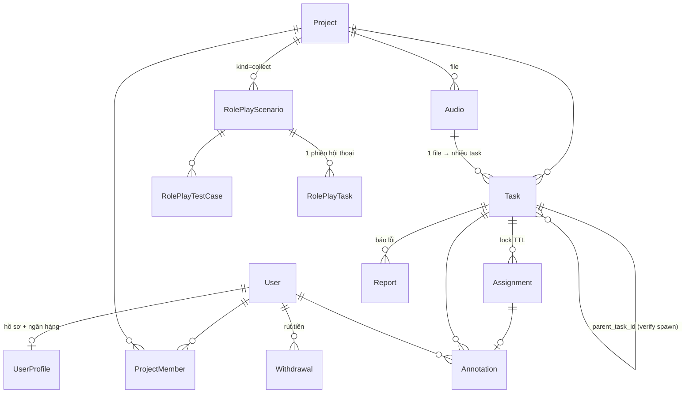

# Kiến trúc hệ thống

Tài liệu này mô tả **code hiện tại** (không phải bản thiết kế). Khi có chỗ khác với [PLAN.md](PLAN.md), code và tài liệu này là chuẩn.

## 1. Tổng quan

```
┌──────────────────────┐   HTTP JSON + cookie JWT   ┌──────────────────────────┐
│  Frontend (Vite)     │ ─────────────────────────▶ │  Backend FastAPI          │
│  React SPA :7777     │ ◀───────────────────────── │  :8765  /api/*            │
└─────────┬────────────┘                            │                          │
          │ GET presigned URL (audio)               │  routers → services       │
          ▼                                         │           │      │        │
┌──────────────────────┐   put / presign            │           ▼      ▼        │
│  MinIO :9100         │ ◀───────────────────────── │       SQLite   MinIO      │
│  bucket "audios"     │                            └───────────┬──────────────┘
└──────────────────────┘                                        │ WebSocket proxy
                                                                ▼
                                                   ┌──────────────────────────┐
                                                   │ Voice-bot agent (ngoài)  │
                                                   │ /v1/voice-bot/ws         │
                                                   └──────────────────────────┘
```

- **Frontend** gọi API bằng axios với `withCredentials: true`. Audio được phát trực tiếp từ MinIO qua **presigned URL** (TTL 600s) do backend cấp.
- **Backend** là một process FastAPI duy nhất. Không có worker, queue hay cron. Các việc dọn dẹp như hết hạn lock được làm *lazy* ngay trong request.
- **Database:** SQLite qua SQLAlchemy, mặc định ở `~/.annotator/annotator.db` khi chạy local. Không có Alembic: bảng được tạo bằng `create_all` khi khởi động (xem [DEVELOPMENT.md](DEVELOPMENT.md#thay-đổi-schema-db)).
- **Role-play:** browser ↔ backend ↔ agent qua WebSocket. Backend đứng giữa để xác thực, ghi âm 2 kênh và lưu kết quả.

## 2. Backend — phân tầng

```
routers/   Nhận request, validate bằng schema, kiểm tra quyền (Depends), gọi service. Không chứa logic nghiệp vụ.
services/  Toàn bộ business logic. Mỗi service nhận `Session` (và `StorageService` nếu cần), raise HTTPException khi lỗi nghiệp vụ.
models/    SQLAlchemy ORM. Enum lưu dạng String, giá trị hợp lệ ghi trong comment ngay cạnh cột.
schemas/   Pydantic DTO cho request/response.
core/      config (pydantic-settings, đọc .env), database (engine, get_db, utcnow), security (bcrypt, JWT), storage (MinIO).
```

**Dependency injection:** `get_db()` mở một session cho mỗi request. Service được tạo qua factory `get_xxx_service(db)` và inject bằng `Depends`.

**Phân quyền** (`routers/deps.py`):
- `get_current_user`: đọc JWT từ cookie `access_token`, trả 401 nếu thiếu hoặc sai.
- `require_role("admin")`: trả 403 nếu không đủ role.
- Quyền theo project nằm trong service: `ProjectService.assert_member` và `AllocationService._assert_can_access`. Admin luôn qua; project `public` cho mọi user đăng nhập; project `private` chỉ cho member.

**Trạng thái tài khoản** (`User.account_status`): `active` | `under_review` | `suspended`. User `under_review` hoặc `suspended` **không** nhận task, submit, report, sửa annotation hay rút tiền được.

## 3. Domain model



| Bảng | Vai trò | Trường quan trọng |
|---|---|---|
| `users` | Tài khoản | `role` (`admin`/`annotator`), `account_status` |
| `user_profiles` | Thông tin cá nhân + ngân hàng (bắt buộc trước khi rút) | `bank_*` |
| `projects` | Đơn vị cấu hình | `kind` (`annotate`/`collect`), `task_types`, `scoring` `{task_type: điểm}`, `redundancy`, `repeat_ratio`, `golden_ratio`, `status` (`draft`/`active`/`closed`), `visibility` (`private`/`public`), `agent_endpoint` |
| `project_members` | User thuộc project private | `role` (`member`/`manager`) |
| `audios` | Metadata file trong MinIO | `minio_key`, `mime`, `duration_sec` |
| `tasks` | Đơn vị công việc | `task_type`, `payload` (schema theo type), `is_golden`, `golden_answer`, `parent_task_id`, `source_annotation_id` |
| `assignments` | Khoá 1 task cho 1 user | `status` (`active`/`completed`/`released`/`expired`), `expires_at` |
| `annotations` | Câu trả lời | `answer`, behavior signals, `low_engagement`, `is_repeat_check`, `review_status` (`pending`/`approved`/`rejected`), `score_awarded` |
| `reports` | Annotator báo audio lỗi | `reason`, `status`, `score_awarded` |
| `withdrawals` | Yêu cầu rút tiền | `amount_points`, `amount_vnd`, snapshot ngân hàng, `status` (`pending`/`approved`/`rejected`/`paid`) |
| `roleplay_scenarios` / `roleplay_test_cases` / `roleplay_tasks` | Thu thập hội thoại với voice-bot | `use_case`, `max_tasks_per_user`, `recording_minio_key`, `report_data`, `report_rating` |

> `Task` có các property proxy như `task.minio_key` và `task.duration_sec` trỏ sang `task.audio.*` để tương thích với code cũ. Code mới nên dùng `task.audio.<field>`.
>
> Trong code và API, nhiều chỗ còn gọi Task là "audio" (ví dụ router `audios.py` có prefix `/projects/{id}/tasks`, biến `audio` thường là một `Task`). Đây là tên lịch sử, đừng nhầm với bảng `audios`.

### Loại task

| `task_type` | `payload` (input) | `answer` (output) | Tên trên UI |
|---|---|---|---|
| `audio_label` | `{ prelabel?: str }` | `{ text }` | Nghe → Viết |
| `audio_verify` | `{ suggested_label: str }` | `{ verdict: "correct" \| "incorrect" }` | Xác nhận âm thanh |
| `qa` | `{ question, options?: [] }` | `{ text }` \| `{ option }` \| `{ audio_key, mime, size_bytes }` (ghi âm) | Hỏi đáp |

Validator nằm ở 2 chỗ: `REQUIRED_BY_TASK_TYPE` (payload, khai báo trùng ở `audio_service.py` và `prelabel_parser.py`) và `REQUIRED_ANSWER_BY_TYPE` (answer, trong `allocation_service.py`).

## 4. Các luồng nghiệp vụ chính

### 4.1 Nạp dữ liệu (admin) — `AudioService`
- **Upload:** `POST /projects/{id}/tasks/upload` (multipart). Kiểm tra mime `audio/*`, tối đa 50MB/file và 200 file/lần. Ghi file vào MinIO, tạo 1 `Audio` và 1 `Task`. Task type phải nằm trong `project.task_types`.
- **Prelabel:** upload CSV/JSONL/XLSX có cột `filename` và các trường theo task type (`prelabel_parser.py`). Có endpoint tải file template.
- **Câu hỏi QA:** tạo task `qa` hàng loạt từ file câu hỏi.
- **Sync:** kéo file từ một MinIO/S3 bên ngoài (`ExternalSyncClient`), tối đa 500 file/lần.

### 4.2 Phân bổ task — `AllocationService`
Có 2 cách lấy task:
- `GET /me/next-task?task_type=` (**global**, trang Annotate dùng cái này): chọn ngẫu nhiên trong các project `active` mà user được truy cập.
- `GET /projects/{id}/next-task`: chỉ lấy trong một project.

Thuật toán (`_try_assign_in`):
1. **Dọn lock hết hạn** (`_sweep_expired`): mọi assignment `active` đã quá `expires_at` chuyển thành `expired`.
2. **Tiếp tục task đang dở:** nếu user còn assignment `active` thì trả lại task đó. Mỗi user chỉ có 1 lock tại một thời điểm.
3. **Repeat check:** với xác suất `project.repeat_ratio`, giao lại một task user *đã làm* để kiểm tra độ nhất quán. Annotation này có `is_repeat_check=true`, vẫn được tính điểm nhưng không tính vào redundancy hay consensus.
4. **Lọc ứng viên:** task `ready`, đúng type, user chưa làm và chưa từng lock, `active + done < redundancy`, đủ trường payload bắt buộc. Loại task `audio_verify` sinh ra từ label của **chính user đó** (không cho tự verify).
5. **Chọn task:**
   - Chế độ *Ngẫu nhiên* (global, không lọc type) chọn theo thứ tự ưu tiên: T1 task chưa ai làm → T2 task có ≥2 câu trả lời đang bất đồng → T3 các task còn lại.
   - Các chế độ khác ưu tiên task *gần đủ redundancy* để hoàn tất nhanh.
   - Sau đó random trong 20 ứng viên đầu.
6. Tạo `Assignment` với TTL **10 phút** (`LOCK_TTL_MIN`).

Response trả về `audio_url` (presigned), `payload`, `expires_at` và tiến độ.

### 4.3 Nộp bài & chấm điểm sơ bộ
`POST /assignments/{id}/submit` (hoặc `/submit-voice` cho câu trả lời QA bằng ghi âm, tối đa 10MB, lưu ở `annotations/{project}/{assignment}-{user}.{ext}`):
- Kiểm tra assignment thuộc user, còn `active` và chưa hết hạn (hết hạn thì trả **410**).
- Validate answer theo task type.
- **Low engagement:** bị đánh dấu nếu nghe < 50% thời lượng audio hoặc làm < 2 giây. Khi đó `score_awarded = 0`.
- Nếu không bị đánh dấu: `score_awarded = project.scoring[task_type]`, với `review_status = pending`.
- **Spawn verify:** nếu task là `audio_label` gốc, project có bật `audio_verify`, không phải repeat check và text không rỗng, hệ thống sinh 1 task `audio_verify` mới dùng chung file audio, với `suggested_label` là text vừa nộp. Task con không spawn tiếp.
- `POST /assignments/{id}/skip`: nhả lock (`released`), không mất điểm.
- Khi annotation còn `pending`, annotator có thể sửa câu trả lời (`PATCH /me/annotations/{id}`). Điểm và cờ `low_engagement` **không** được tính lại (chống lách).

### 4.4 Review & tự động khoá — `ReviewService`
- Admin duyệt theo từng annotation (`/admin/annotations/pending`) hoặc theo dữ liệu (`/admin/review/by-data`, gom các câu trả lời trên cùng một file).
- **Approve:** giữ nguyên `score_awarded`, điểm chuyển thành *đã xác nhận*.
- **Reject:** `score_awarded = 0` (thu hồi).
- Sau mỗi lần review, `_check_auto_flag` chạy: nếu user đã có ≥ **10** annotation được review và tỉ lệ reject ≥ **30%** thì chuyển sang `under_review`. Khi tỉ lệ giảm xuống dưới 30% thì tự mở lại thành `active`. Admin có thể đổi trạng thái thủ công qua `/admin/users/{id}/account-status`.

### 4.5 Báo lỗi dữ liệu — `ReportService`
Annotator report task đang làm (lý do: `corrupt`, `inaudible`, `wrong_label`, `offensive`, `other`). Mỗi task chỉ được report 1 lần. Admin approve thì annotator nhận điểm bằng `scoring[task_type]`; reject thì không có điểm, nhưng cũng **không** tính vào tỉ lệ lỗi.

### 4.6 Ví & rút tiền — `WalletService`
```
score_confirmed  = Σ annotation.score_awarded (approved) + Σ report.score_awarded (approved)
score_pending    = Σ annotation.score_awarded (pending)
withdrawn        = Σ withdrawal.amount_points  (pending | approved | paid)
available_points = max(0, score_confirmed − withdrawn)
```
- Tỉ lệ quy đổi và ngưỡng rút nằm trong config: `POINT_TO_VND=50`, `MIN_WITHDRAWAL_POINTS=100`.
- Để rút tiền, tài khoản phải `active` và hồ sơ phải có đủ thông tin ngân hàng. Thông tin ngân hàng được snapshot vào bản ghi `Withdrawal`.
- Trạng thái: `pending → approved → paid`, hoặc `pending → rejected` (điểm được hoàn lại vì không còn bị trừ).
- Số dư **không lưu thành cột riêng** mà luôn tính lại từ các bảng nguồn.

### 4.7 Role-play (project `kind=collect`) — `RolePlayService` + `roleplay_ws_proxy`
1. Admin cấu hình `agent_endpoint` cho project. Sau đó import scenario từ agent (`/agent-use-cases`) hoặc tạo tay, rồi thêm test case (vai annotator cần đóng).
2. Annotator chọn scenario + test case → `POST /roleplay/tasks` tạo `RolePlayTask` (`running`). Hệ thống kiểm tra `max_tasks_per_user`; các task cũ còn treo bị chuyển thành `failed`.
3. Browser mở `WS /api/roleplay/tasks/{id}/ws` (xác thực bằng cookie). Backend mở kết nối tới `{agent}/v1/voice-bot/ws?client_id&language&use_case` và chuyển tiếp 2 chiều.
4. Khi phiên đóng, backend ghép **WAV stereo** (mic ở kênh trái, agent ở kênh phải, PCM 16kHz 16-bit) và lưu vào MinIO. Dữ liệu agent thu thập được lưu vào `report_data`.
5. Annotator chấm điểm phiên (`report_rating`, `report_note`).

> Role-play hiện **không cộng điểm** vào ví.

## 5. Frontend

- **Entry:** `main.tsx` → `AuthProvider` (gọi `/auth/me`) → `RouterProvider` (`router.tsx`).
- **Route guard:** `ProtectedRoute` (bắt buộc đăng nhập) và `AdminRoute` (bắt buộc role admin).
- **Tổ chức theo feature** (`src/features/<domain>`). Mỗi domain có file API tương ứng trong `src/api/<domain>.ts` và type trong `src/lib/<domain>Types.ts`.

| Route | Màn hình | Quyền |
|---|---|---|
| `/dashboard` | Tổng quan, chọn chế độ gán (`features/annotate/modes.ts`) | user |
| `/projects`, `/projects/:id` | Danh sách / chi tiết project. Tab cho admin: Dữ liệu, Dữ liệu kiểm soát, Thành viên, Nhiệm vụ (điểm), Báo cáo, Cấu hình. Project `collect` có tab Role play | user / admin |
| `/projects/:id/annotate` | Màn hình gán nhãn (`AnnotatePage`, `AudioPlayer` dùng wavesurfer, `VoiceRecordCard`, `ReportModal`) | user |
| `/rewards`, `/history` | Điểm, lịch sử annotation, sửa câu trả lời đang pending | user |
| `/withdrawals`, `/settings` | Rút tiền, hồ sơ + ngân hàng | user |
| `/roleplay`, `/roleplay/:id`, `/roleplay/history` | Danh sách scenario, phiên hội thoại (`useWebSocketAgent.ts`), lịch sử | user |
| `/projects/new`, `/admin/review`, `/admin/flagged`, `/admin/withdrawals`, `/admin/reports` | Quản trị | admin |

Lỗi API được chuẩn hoá bằng `extractError()` trong `api/client.ts`, đọc `detail` của FastAPI.

## 6. Bảo mật

- Mật khẩu hash bằng bcrypt (passlib). JWT HS256 sống 60 phút, lưu trong cookie `httpOnly` với `SameSite=lax`. `secure=false` khi dev, **phải bật** khi chạy production (`COOKIE_SECURE=true`).
- CORS chỉ cho các origin trong `CORS_ORIGINS`, có `allow_credentials`.
- Luồng gán nhãn bình thường chỉ đưa audio cho annotator qua `next-task`, bằng presigned URL ngắn hạn.
- ⚠️ **Lỗ hổng đã biết:** 3 endpoint sau chỉ kiểm tra *membership* (`assert_member`), **không** yêu cầu admin. Với project `public`, mọi user đăng nhập đều gọi được:
  - `GET /projects/{id}/tasks`: liệt kê toàn bộ task, kèm `payload` và cờ `is_golden`.
  - `GET /projects/{id}/tasks/{task_id}/presigned`: lấy URL tải audio bất kỳ.
  - `GET /projects/{id}/tasks/{task_id}/annotators`: xem email và câu trả lời của annotator khác.

  Điều này trái với mục 1–3 trong [concerns.md](concerns.md). Cần chuyển sang `require_role("admin")` (hoặc manager của project) trước khi mở cho người ngoài.
- Các mối lo khác: [concerns.md](concerns.md).

## 7. Chưa làm / khác với PLAN.md

| Hạng mục | Hiện trạng |
|---|---|
| Golden dataset | Có cột `is_golden`, `golden_answer`, `golden_ratio` và tab "Dữ liệu kiểm soát", nhưng **chưa chấm** `golden_correct` và chưa chèn golden theo `golden_ratio` khi phân bổ. |
| Consensus | Chỉ dùng để *ưu tiên* phân bổ (T2). Chưa tự động approve/reject theo đa số. |
| Audio proxy / watermark | PLAN dự định stream qua backend. Code hiện tại dùng presigned URL MinIO trực tiếp. |
| Hold period 7 ngày, accuracy multiplier, bonus, KYC, earning cap | Chưa làm. Điểm chỉ phụ thuộc admin approve. |
| Refresh token | Chưa có. Token hết hạn sau 60 phút thì phải đăng nhập lại. |
| DB | PLAN ghi MongoDB, thực tế dùng SQLite + SQLAlchemy và chưa có migration. |
| Test tự động | Chưa có. |
